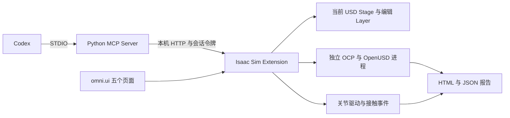

# Omniverse 工站智能体设计

目标环境为 Linux x86_64、Isaac Sim 6.1.0、Python 3.12 和 PhysX。开发环境为 Windows；真实 Isaac 运行验收需要目标机器。

## 连接与执行

MCP 使用官方 Python SDK。Extension 只监听 `127.0.0.1`，默认端口 8765，要求长度不少于 16 的会话令牌。GUI 与 MCP 共用 Dispatcher 和 JobManager。USD 操作在 Kit 事件循环执行；几何计算使用独立 Python 进程，隔离 Kit 的 Python 和动态库环境。

请求携带 `request_id`；相同请求返回同一个任务。场景修改要求当前 `scene_revision`。任务具有 queued、running、succeeded、failed、cancelled 状态。启动运动的任务完成后，通过独立 `run_id` 和 `motion_status` 跟踪实际动作。

Stage 切换时停止接收旧场景请求，取消旧任务、释放订阅并建立新会话。转换和几何进程可取消；运动支持暂停、继续、终止和复位。

## 七项功能

| 功能 | 实现 |
| --- | --- |
| STEP / USD | OCP STEPCAFControl 读取装配与实例；同一 BRep 生成 USD Mesh 和几何文件，记录 SHA-256 与 Prim 映射 |
| 材质 | UsdShade / UsdPreviewSurface；颜色、金属度、表面参数、透明度和纹理；纹理复制到工程并保存相对路径 |
| 物理 | UsdPhysics 设置刚体、质量、惯量、摩擦、恢复系数与碰撞近似；没有 PhysicsScene 时创建重力场景 |
| 机构 | 固定、旋转、移动 Joint；BRep 平面和圆柱查询；世界坐标锚点转换为两个部件的局部坐标 |
| 资产验证 | 查询官方注册类别；调用 Asset Validator 和 Isaac Sim 注册规则；保存原始结果及覆盖范围 |
| 运动 | 三角形或梯形速度曲线、动作依赖、实际位置到位判定、超时与运行控制；接受后保存运动 JSON |
| 干涉检查 | 静态 BRep 共同体积与最小距离；运动 PhysX 接触事件、允许接触规则、CCD 和时间步设置；输出报告 |

输入长度使用 m，角度使用 rad，时间使用 s，质量使用 kg；USD 属性按其单位要求换算。机构轴线、质量和工艺顺序使用已知工程参数。

## 场景与文件

交互操作持有当前打开的 Stage。编辑在临时 Layer 中完成，成功后提交；失败移除本次 Layer。设置实例部件物理属性时，解除该部件的实例状态以编辑其 collider。

保存工程生成 USD 入口、编辑 Layer、工程 JSON 及运动配置索引，保留已有 session 编辑和当前源子层内容。外部引用资产包含未保存修改时明确报告，要求处理对应资产。原始 STEP 和 USD 文件不被工程保存操作改写。

转换结果位于工程 `assets/`，包含 `workcell.usda`、`geometry.usdc`、`geometry.json` 和 BRep 文件。静态检查导出当前 Stage 的快照；`asset_root` 映射转换前后的装配根路径。检查返回快照版本、当前版本与检查期间是否发生修改。

## 检查判定

静态检查按长度容差扩展包围盒，候选对执行 BRep 共同实体和最小距离计算。共同体积超过体积容差记为 interference；距离不超过长度容差记为 contact。未映射的几何列出路径，覆盖不完整时不提供整场景无干涉结论。Mesh 拓扑、几何文件哈希或不支持的变换改变时停止计算。

运动检查保存实际接触事件、接触点、对象、仿真时刻和允许规则分类。覆盖范围明确记录碰撞近似、过滤条件、CCD、时间步和轨迹是否完成。完整 SimReady profile 状态需要完整规则证据，部分规则报告的 `profile_conformance` 保持 `not_evaluated`。

## 操作入口与验证

GUI 提供资产、物理、机构、运动、检查五个页面，共用 JSON 参数、任务状态、选择对象和问题路径定位。Codex 使用 `workcell-workflow` Skill，并按需读取项目附带的五个 NVIDIA 官方 Skills；上游版本和许可证保留。

- Windows：真实 OpenUSD/OCP 文件、数学轨迹、报告、HTTP 和 MCP 进程测试。
- GitHub Linux CI：固定依赖安装、核心测试、脚本和代码检查。
- Linux Isaac：7 项真实运行测试和 Extension HTTP 验收；GUI 人工操作另按验收文档记录。

固定版本与官方接口依据见 [compatibility.md](../../compatibility.md)，运行步骤见 [linux-validation.md](../../linux-validation.md)。
